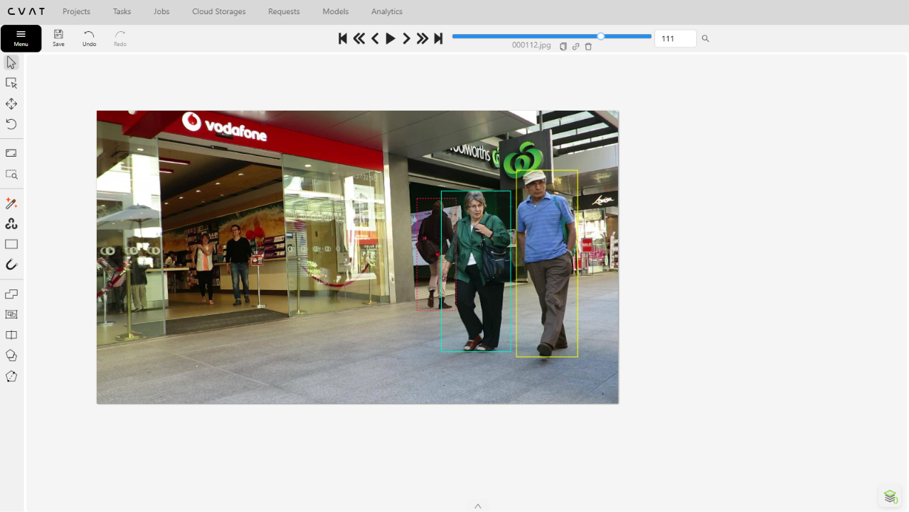
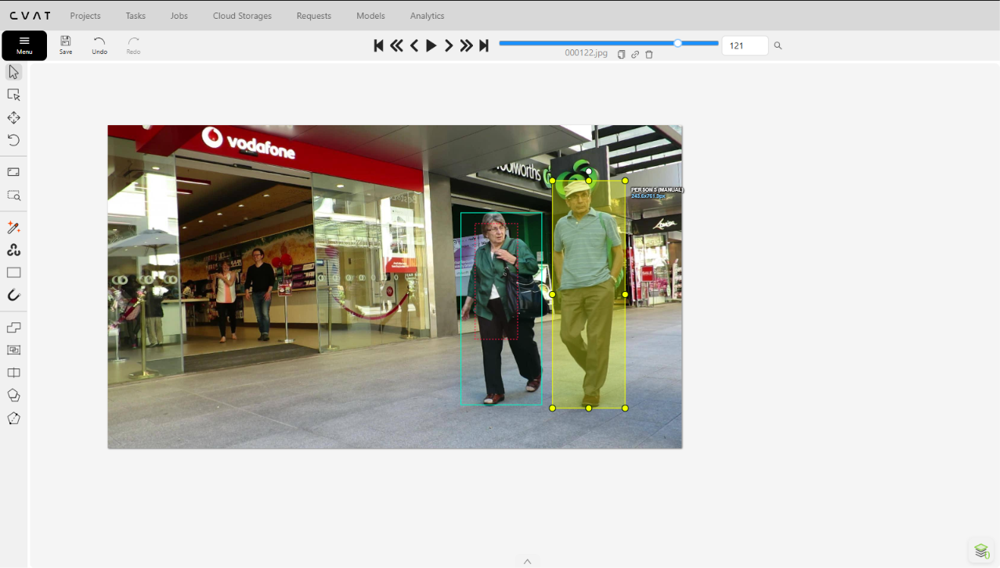
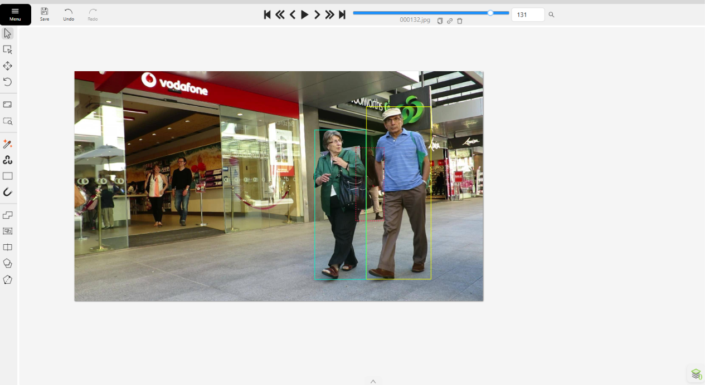

# Báo cáo cá nhân — HoVaTen-MSSV

Đổi tên file theo quy tắc `MSSV_HoTen.md`. Ví dụ: `20241234_NguyenVanAn.md`.

Đoạn video: MOT17-09, 150 frame (frame 1–150), nguồn MOTChallenge, giấy phép CC BY-NC-SA 3.0.

## 0. Thông tin học viên

- Họ tên:Trần Đức Kỳ
- MSSV:2A202603277
- Mã đề (A/B/C):C
- Email: tranducky03@gmail.com
- Link repository:https://github.com/STSGx5/K5-L2-DAY05-TranDucKy-2A202603277-MOTTracking.git
- Giờ bắt đầu:18h
- Giờ kết thúc:0h11 

## 1. Xem trước đoạn video (CP0)

Ghi **trước khi vẽ**, mỗi người một dòng.

| Mã | Frame xuất hiện | Frame cuối thấy được | Rẽ / dừng / đổi tốc độ ở frame | Bị che ở frame | Ghi chú |
|---|---|---|---|---|---|
| P1 |0 |140 |~40 rẽ ~50 tăng tốc độ  |~116 (đi sau người khác) | bị che hết rồi xuất hiện lại |
| P2 |0 |149 |~20 tăng tốc |không rõ | |
| P3 |0 |106 |~20-39 đi chậm ~40 dừng  | ~100 (do bị người khác đi qua )| Bị che hết các frame còn lại |
| P4 |0 |111 |~20-39 đi chậm ~40 dừng  | ~107 (do bị người khác đi qua  | |
| P5 |20 |149 |~27 tăng tốc |không rõ |Vào frame khi chỉ có dưới 20% cơ thể |

## 2. Keyframe và thời gian (CP1, CP4)

Số keyframe lấy từ kết quả `src/check_submission.py`.

| Mã | Số keyframe | Keyframe ở frame | Số frame có mặt | Keyframe / 100 frame | Thời gian (phút) | Chỗ khó |
|---|---|---|---|---|---|---|
| P1 |53 |0, 1, 2, 4, 7, 8, 9, 15, 18, 21, 24, 25, 26, 27, 29, 31, 34, 35, 36, 37, 38, 39, 40, 41, 42, 43, 44, 45, 48, 49, 50, 51, 54, 55, 60, 70, 80, 90, 100, 102, 103, 107, 108, 110, 111, 114, 116, 117, 120, 122, 125, 130, 131 | 135| 39.3 |19 | đi sau người khác và sau hiện ra rồi lại bị che |
| P2 |29 |0, 1, 2, 12, 20, 30, 40, 50, 55, 60, 70, 80, 90, 97, 100, 102, 107, 110, 117, 120, 122, 125, 127, 130, 131, 137, 138, 140, 149|150 | 19.3|10 | |
| P3 |11|0, 2, 10, 20, 30, 40, 50, 107, 108, 109 |106 | 10.4  |13 | |
| P4 |10 |0, 2, 10, 20, 30, 40, 50, 107, 108, 109 |109 | 9.2 | 11| |
| P5 |19|20, 30, 40, 50, 60, 70, 80, 90, 97, 100, 107, 110, 117, 120, 122, 130, 137, 140, 149 | 129| 14.7 | 20| |
| **Tổng** |122 | |629 | | 74| |

Keyframe / 100 frame của cả bài = tổng keyframe ÷ tổng số frame có mặt × 100 = 19.4

Bạn đặt keyframe nhiều nhất ở người nào? Vì sao (người đó rẽ, dừng, lại gần camera hay bị che)?
Người p1 vì người đó rẽ và sau đó tăng tốc rồi bị che khuất 1 phần 
## 3. Đoạn bị che (CP2)

Người bị che: `P1`

| Mốc | Frame |
|---|---:|
| Bắt đầu bị che một phần (bật `occluded`) | ~110 |
| Mất hẳn (bật `outside`) |121 |
| Hiện lại (tắt `outside`) |131 |
| Thấy rõ trở lại (tắt `occluded`) | 135|

- Thời gian khuất hẳn: 14 frame = ~0,47 giây.
- Quyết định: giữ cùng ID 
- Lý do (trả lời 3 câu: khuất bao lâu so với 60 frame, ngoại hình có khớp, chỗ hiện lại có đúng hướng và tốc độ):
-Khuất hẳn 14 frame ≪ 60 frame (ngưỡng 2 giây của lớp) → đủ điều kiện giữ cùng track.
-Áo/quần và dáng lúc hiện lại khớp P1 trước khi che; không nhầm với người đi ngang.
-Hiện lại đúng phía đường đi cũ, tốc độ tương đương → tắt outside ở 135,

Ảnh chụp màn hình:

## 4. Tự review ID (CP3)

Lượt 1 theo người (đi ngược từ frame 149 về 0 trên CVAT), lượt 2 theo cảnh (nhảy 10 frame). Ít nhất 3 dòng; không có lỗi thì ghi một dòng "đã kiểm hai lượt, không lỗi".

Loại lỗi dùng đúng một trong 7 mã: `id_switch`, `fragmentation`, `lost`, `merge`, `false_track`, `drift`, `flag`.

| Frame | Mã người | Loại lỗi | Mô tả một câu | Phát hiện ở lượt | Đã sửa? |
|---:|---|---|---|---|---|
|50 |P1 |drift |Box nội suy lệch phần chân ra ngoài box |1 |Đã sửa |
|106|P3 |flag |Đã mất hẳn nhưng quên bật outside sớm, vẫn thấy box mờ |1 | Đã sửa |
|135 |P1 |flag |Đã mất hẳn nhưng quên bật outside sớm, vẫn thấy box mờ |1 | Đã sửa |

Tổng hợp số lỗi theo loại:

| `id_switch` | `fragmentation` | `lost` | `merge` | `false_track` | `drift` | `flag` |
|---:|---:|---:|---:|---:|---:|---:|
| | | | | | 1|2 |

Lỗi nào chỉ lượt 2 (theo cảnh) mới thấy, lượt 1 (theo người) không thấy? Vì sao?

không có 

## 5. File xuất và kết quả tự kiểm (CP4)

| Kiểm tra | Kết quả |
|---|---|
| Tên file MOT 1.1 | Tranducky_mot.zip |
| Tên file CVAT for video 1.1 |Tranducky_cvat_video.zip |
| Số track ID khác nhau trong `gt/gt.txt` (phải là 5) | 5|
| Frame `outside` không có dòng trong `gt.txt` (đúng / sai) | đúng|
| Job đã completed trên CVAT máy cá nhân | có |

Dán phần tóm tắt in ra từ `src/check_submission.py`:

 Track | Frame có mặt | Số frame | Đoạn vắng (outside)
      1 |   0–134      |      135 | -
      2 |   0–149      |      150 | -
      3 |   0–105      |      106 | -
      4 |   0–109      |      109 | 106
      5 |  20–149      |      129 | 106

## 6. Ba câu kết

1. Nếu được gán lại, bạn sẽ đặt keyframe khác ở đâu? Vì sao?

  frame 50 vì bị lệch so với người thật 

2. Có chỗ nào bạn không chắc "cùng ID hay ID mới"? Bạn đã quyết định và ghi chú thế nào?

Không có

3. Một lỗi ID trong job của bạn (nếu không còn sót, chọn lỗi đã sửa) có thể làm xe tự lái dự đoán sai chuyển động của người đó như thế nào? Lỗi đó ảnh hưởng MOTA hay IDF1 nhiều hơn?

 Đánh giá sai ý định di chuyển: Nếu người đi bộ đang đi nhanh hướng về phía lòng đường để băng qua, việc mất dấu lịch sử khiến hệ thống không nhận diện được đà di chuyển (momentum). Xe có thể dự đoán nhầm rằng người này đang đứng yên hoặc đi chậm ở mép đường, dẫn đến việc không giảm tốc độ kịp thời.

## Bonus (nếu làm)

### B1 — Hai người đi sát

Không làm

### B2 — So cách đặt keyframe

| Cách đặt | Số keyframe | Frame trôi nhất | Ghi chú |
|---|---:|---:|---|
| Đều mỗi 30 frame | | | |
| Theo chỗ đổi hướng | | | |

Không làm

### B3 — So với tracker có sẵn
Không làm
| Frame | Mã người | Tracker làm gì | Nhãn của bạn | Giải thích (đoán rồi sửa / ghép IoU / box score thấp / ngoại hình) |
|---:|---|---|---|---|
| | | | | |
| | | | | |

## 7. Tài liệu tham khảo và công cụ AI đã dùng

...
